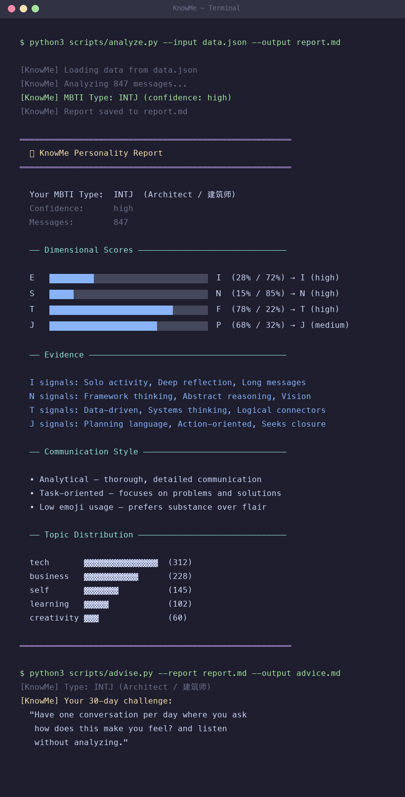

# KnowMe

[English](./README_EN.md) | 中文

> **从真实对话，了解自己，也读懂别人。**

KnowMe 从 ChatGPT、Claude、OpenClaw、飞书和普通聊天文本中提取行为信号，分析指定对象的 MBTI 倾向、沟通方式和决策偏好。它既能分析你与 AI 的长期对话，也能分析你与老板、同事、伴侣、朋友或客户的聊天记录。

[](https://github.com/AIPMAndy/KnowMe/stargazers)
[](https://github.com/AIPMAndy/KnowMe)
[](https://www.python.org/)
[](https://www.feishu.cn/)



## 两种分析模式

| 模式 | 分析什么 | 典型场景 |
|---|---|---|
| **了解自己** | 你在 AI 对话中真实表现出的提问、决策和表达习惯 | 自我认知、职业方向、成长建议 |
| **读懂别人** | 指定聊天参与者自己的消息，不混入另一方语料 | 理解老板、同事、伴侣、朋友、客户 |

传统 MBTI 问卷分析的是“你觉得自己会怎么做”。KnowMe 分析的是人在日常对话里已经做了什么：怎么组织信息、如何要求结果、关注事实还是关系、倾向快速定案还是保留选择。

这种无意识语料能减少自我美化偏差，但它仍然只是行为倾向，不是临床诊断，也不是对一个人的最终定义。

## 飞书对话直接集成

KnowMe 不只是支持“上传一段文字”。安装并登录 `lark-cli` 后，可以直接读取你有权限访问的飞书群聊或私聊，保留发言人，再只分析指定对象。

### 1. 找到飞书会话

```bash
# 按群名查找 chat_id
lark-cli im +chat-search --as user --query "项目群" --format json
```

### 2. 分析老板或同事

```bash
python3 scripts/collect.py \
  --source feishu \
  --chat-id oc_xxx \
  --mode other \
  --target "张经理" \
  --self-name "Andy" \
  --relationship boss \
  --start 2026-07-01 \
  --output data.json

python3 scripts/analyze.py \
  --input data.json \
  --output report.md
```

私聊可以直接使用对方的飞书 `open_id`：

```bash
python3 scripts/collect.py \
  --source feishu \
  --user-id ou_xxx \
  --mode other \
  --target "张经理" \
  --relationship colleague \
  --output data.json
```

### 3. 没有 API 接入时，导入复制文本或 JSON

```bash
python3 scripts/collect.py \
  --source feishu \
  --file ./feishu-chat.txt \
  --mode other \
  --target "张经理" \
  --self-name "Andy" \
  --relationship colleague \
  --output data.json
```

支持以下格式：

- `lark-cli im +chat-messages-list --format json` 的原始 JSON
- 包含 `messages` 数组和 sender 字段的 JSON
- 飞书复制出的 `姓名 时间` 分段文本
- `姓名: 消息内容` 形式的聊天文本

## 分析自己的 AI 对话

```bash
git clone https://github.com/AIPMAndy/KnowMe.git
cd KnowMe

# ChatGPT 导出
python3 scripts/collect.py \
  --source chatgpt \
  --file ~/Downloads/conversations.json \
  --mode self \
  --output data.json

python3 scripts/analyze.py --input data.json --output report.md
python3 scripts/advise.py --report report.md --output advice.md
```

作为 Skill 使用时，可以直接说：

- “分析一下我的性格。”
- “根据这段飞书聊天，看看张经理是什么沟通风格。”
- “分析我和同事的聊天，只看对方发的消息。”
- “这个老板更适合怎么汇报？”

## 报告包含什么

每份报告都会明确显示：

- 正在分析谁，以及是 `self` 还是 `other` 模式
- 数据来源、关系场景、目标消息数和总对话消息数
- E/I、S/N、T/F、J/P 四个维度的比例和置信度
- 来自目标对象本人消息的短证据片段
- 沟通风格和话题分布
- 对他人分析时，下一次沟通可直接采用的建议
- 证据限制和禁止的高风险用途

示例：

```text
Analyzed subject: 张经理
Analysis mode: other
Relationship context: boss
Based on 64 messages from the subject (137 total conversation messages)

Observed MBTI tendency: ESTJ
- 先给结论、数据和截止时间
- 明确负责人和完成标准
- 避免只讲感受而没有决策请求
```

## 支持的数据源

| 来源 | 接入方式 | 分析对象 |
|---|---|---|
| **飞书群聊/私聊** | `--source feishu --chat-id/--user-id` | 指定参与者 |
| **飞书导出/复制文本** | `--source feishu --file` | 指定参与者 |
| **ChatGPT** | `--source chatgpt --file conversations.json` | 自己 |
| **Claude** | `--source claude --file export.json` | 自己 |
| **OpenClaw** | `--source openclaw` | 自己 |
| **普通文本** | `--source text --file` | 自己的 AI 对话 |

## 工作原理

```text
对话数据
  -> 保留发言人
  -> 选择一个分析对象
  -> 扫描中英文行为信号
  -> MBTI 四维加权
  -> 样本量校准置信度
  -> 证据化报告与沟通建议
```

KnowMe 的分析器不调用外部 AI API，评分过程在本地完成。直接读取飞书时，只有经过授权的 `lark-cli` 会访问飞书接口；获取后的分析仍在本机执行。

样本建议：

- 少于 20 条目标消息：低置信度
- 20-49 条：只能作为方向性判断
- 50 条以上，且跨不同日期和话题：更适合形成稳定画像

## 项目结构

```text
KnowMe/
├── SKILL.md
├── agents/openai.yaml
├── scripts/
│   ├── collect.py              # 多源收集、飞书接入、发言人选择
│   ├── analyze.py              # MBTI 信号与沟通建议
│   ├── advise.py               # 自我成长建议
│   ├── auto_collect.py         # OpenClaw 自动收集
│   └── generate_portrait.py    # MBTI 视觉 Prompt
├── references/
│   ├── mbti_signals.md
│   ├── relationship_analysis.md
│   └── advice_frameworks.md
└── tests/test_pipeline.py
```

## 验证

项目只依赖 Python 标准库：

```bash
python3 -m unittest discover -s tests -v
python3 -m compileall -q scripts
```

## 隐私与边界

- 只分析你有权访问的对话。
- 原始聊天默认只保存在本地。
- 他人分析是沟通假设，不是心理或临床诊断。
- 不推断受保护属性、精神健康、诚实程度或真实意图。
- 不用于操控、排斥、招聘、解雇或其他高影响决策。
- 重要判断应通过直接沟通验证。

## Roadmap

- [x] ChatGPT / Claude / OpenClaw 自我分析
- [x] 飞书群聊和私聊直接读取
- [x] 飞书 JSON、复制文本导入
- [x] 指定对象分析，不混合聊天双方
- [x] 职场关系场景与沟通建议
- [x] 样本量置信度校准
- [ ] Web UI
- [ ] 微信聊天记录解析
- [ ] 大五人格与时间线分析

## License

[Apache 2.0](LICENSE)

Built by [AI酋长Andy](https://github.com/AIPMAndy).
