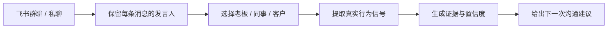

# KnowMe

[English](./README_EN.md) | 中文

## 老板说“再想想”，到底是让你补数据，还是已经不满意？

> **不是又一个 MBTI 测试。KnowMe 把飞书聊天记录，变成一份有证据的职场沟通说明书。**

选中老板、同事或客户，KnowMe 只分析对方自己发过的消息，从真实表达里识别其信息偏好、决策方式和沟通习惯，并告诉你：**下一次该怎么汇报、提问和推进。**

[](https://github.com/AIPMAndy/KnowMe/stargazers)
[](https://github.com/AIPMAndy/KnowMe)
[](https://www.python.org/)
[](https://www.feishu.cn/)

**读懂别人，不靠套话，靠对方自己说过的话。**

## 你不是不会沟通，只是不知道对方按什么规则沟通

- 老板回复“可以”，是真认可，还是让你自己继续推进？
- 同事总问细节，是在挑刺，还是需要足够信息才能做决定？
- 客户迟迟不表态，是不感兴趣，还是还没看到能降低风险的证据？
- 你做过 MBTI 测试，但仍然不知道下一条飞书消息该怎么写。

自填问卷分析的是“一个人觉得自己会怎么做”。真实对话记录的是这个人已经怎么提问、判断、催进度和做决定。KnowMe 不做读心术，也不判断隐藏意图；它把这些可观察的行为信号整理成一个**可以马上用于下一次沟通的假设**。

## KnowMe 解决什么

| 常见做法 | 问题 | KnowMe 的做法 |
|---|---|---|
| 凭感觉猜对方的意思 | 容易把情绪当事实 | 分析对方在真实飞书对话中的表达模式 |
| 把整段聊天直接丢给 AI | 双方语料混在一起，结论可能分析的是你 | 保留发言人，只选择一个对象 |
| 只得到“ESTJ”等标签 | 没有证据，不知道是否可信 | 给出维度、置信度和原话片段 |
| 知道性格，却不知道怎么开口 | 结论无法落到行动 | 按老板、同事、客户等关系给沟通建议 |
| 为了分析上传敏感聊天 | 隐私边界不清 | 分析器不调用外部 AI API，数据默认留在本机 |

KnowMe 支持两种模式：

| 模式 | 分析对象 | 你会得到什么 |
|---|---|---|
| **读懂别人** | 飞书或聊天记录中的指定参与者 | 沟通风格、MBTI 行为倾向、证据、置信度、下一步建议 |
| **了解自己** | 你与 ChatGPT、Claude、OpenClaw 的长期对话 | 提问、决策和表达习惯，以及成长建议 |

## 飞书是核心场景，不是兼容列表里的一个图标

KnowMe 可以通过已授权的 [`lark-cli`](https://github.com/larksuite/cli) 直接读取你有权限访问的飞书群聊或私聊，也支持导入飞书 JSON 和复制文本。整个过程保留发言人，并只把目标对象本人发出的消息送入分析。



一份结果可能长这样：

```text
分析对象：张经理
分析模式：他人
关系场景：老板
样本：目标对象 64 条消息 / 对话共 137 条消息

观察到的 MBTI 倾向：ESTJ
沟通建议：
- 先给结论，再补数据和过程
- 明确负责人、截止时间和完成标准
- 不要只描述困难，同时给出需要他决定的选项

证据片段：只引用张经理本人发过的消息
```

性格标签不是终点。**让下一次汇报少一次误解、少一次返工，才是 KnowMe 的价值。**

## 3 分钟分析一段飞书对话

### 1. 安装 KnowMe 和飞书 CLI

```bash
git clone https://github.com/AIPMAndy/KnowMe.git
cd KnowMe

npm install -g @larksuite/cli
lark-cli auth login --domain im
lark-cli whoami
```

KnowMe 的分析器只依赖 Python 3.8+ 标准库。只有“直接读取飞书”需要额外安装 `lark-cli`；如果使用导出的 JSON 或复制文本，则不需要飞书 CLI。

### 2. 找到飞书群聊

```bash
lark-cli im +chat-search --as user --query "项目群" --format json
```

### 3. 选择一个人分析

```bash
python3 scripts/collect.py \
  --source feishu \
  --chat-id oc_xxx \
  --mode other \
  --target "张经理" \
  --self-name "Andy" \
  --relationship boss \
  --start 2026-07-01 \
  --output data.json

python3 scripts/analyze.py \
  --input data.json \
  --output report.md
```

私聊可以把 `--chat-id oc_xxx` 换成对方的飞书 `--user-id ou_xxx`。

### 没有 API 接入？直接导入复制文本

```bash
python3 scripts/collect.py \
  --source feishu \
  --file ./feishu-chat.txt \
  --mode other \
  --target "张经理" \
  --self-name "Andy" \
  --relationship colleague \
  --output data.json

python3 scripts/analyze.py --input data.json --output report.md
```

支持 `lark-cli` 原始 JSON、包含 sender 字段的 `messages` 数组、飞书复制的 `姓名 时间` 分段文本，以及 `姓名: 消息内容` 格式。

## 也可以从 AI 对话里了解自己

```bash
python3 scripts/collect.py \
  --source chatgpt \
  --file ~/Downloads/conversations.json \
  --mode self \
  --output data.json

python3 scripts/analyze.py --input data.json --output report.md
python3 scripts/advise.py --report report.md --output advice.md
```

同样支持 Claude 导出和 OpenClaw 工作区。作为 Agent Skill 使用时，你可以直接说：

- “分析我和老板的飞书聊天，只看老板发的消息。”
- “这个同事更习惯怎么接收信息？”
- “根据这段对话，我下一次应该怎么汇报？”
- “从我的 AI 对话分析一下我的性格。”

<details>
<summary>查看自我分析终端报告示例</summary>


</details>

## 报告里有什么

- 明确的分析对象，以及 `self` / `other` 模式
- 数据来源、关系场景、目标消息数和总消息数
- E/I、S/N、T/F、J/P 四个维度的倾向与置信度
- 只来自目标对象本人消息的证据片段
- 沟通风格、话题分布和关系相关建议
- 样本限制、适用边界和禁止的高风险用途

样本越多、日期和话题越分散，画像越稳定：

- 少于 20 条目标消息：低置信度
- 20-49 条：只作为方向性判断
- 50 条以上且跨多个日期和话题：更适合形成稳定画像

## 支持的数据源

| 来源 | 接入方式 | 分析对象 |
|---|---|---|
| **飞书群聊 / 私聊** | `--source feishu --chat-id/--user-id` | 指定参与者 |
| **飞书 JSON / 复制文本** | `--source feishu --file` | 指定参与者 |
| **ChatGPT** | `--source chatgpt --file conversations.json` | 自己 |
| **Claude** | `--source claude --file export.json` | 自己 |
| **OpenClaw** | `--source openclaw` | 自己 |
| **普通文本** | `--source text --file` | 自己的 AI 对话 |

## 隐私与边界

- 只分析你有权访问的对话，并在必要时征得参与者同意。
- 原始聊天默认只保存在本地，分析器不调用外部 AI API。
- 直接读取飞书时，只有经过授权的 `lark-cli` 会访问飞书接口。
- 他人分析是基于文字样本的沟通假设，不是心理或临床诊断。
- 不推断受保护属性、精神健康、诚实程度或真实意图。
- 不用于操控、排斥、招聘、解雇或其他高影响决策。
- 重要判断应通过直接沟通验证。

## 项目结构

```text
KnowMe/
├── SKILL.md
├── agents/openai.yaml
├── scripts/
│   ├── collect.py              # 多源收集、飞书接入、发言人选择
│   ├── analyze.py              # MBTI 信号、证据与沟通建议
│   ├── advise.py               # 自我成长建议
│   ├── auto_collect.py         # OpenClaw 自动收集
│   └── generate_portrait.py    # MBTI 视觉 Prompt
├── references/
│   ├── mbti_signals.md
│   ├── relationship_analysis.md
│   └── advice_frameworks.md
└── tests/test_pipeline.py
```

## 验证

```bash
python3 -m unittest discover -s tests -v
python3 -m compileall -q scripts tests
```

## Roadmap

- [x] ChatGPT / Claude / OpenClaw 自我分析
- [x] 飞书群聊和私聊直接读取
- [x] 飞书 JSON、复制文本导入
- [x] 指定对象分析，不混合聊天双方
- [x] 职场关系场景与可执行沟通建议
- [x] 证据引用与样本量置信度
- [ ] Web UI
- [ ] 微信聊天记录解析
- [ ] 大五人格与时间线分析

如果 KnowMe 帮你少猜了一次、少返工了一次，欢迎点一个 [Star](https://github.com/AIPMAndy/KnowMe) 让更多人看到它。

## License

[Apache 2.0](LICENSE)

Built by [AI酋长Andy](https://github.com/AIPMAndy).
