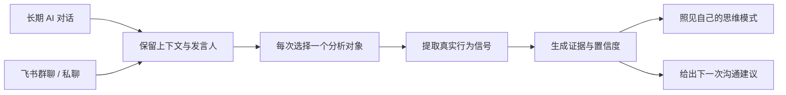

# KnowMe

[English](./README_EN.md) | 中文

## 你以为你很了解自己，长期对话可能不这么认为

> **用 KnowMe，让自己不再自以为是。**

这里的“自以为是”，不是傲慢，而是把“我以为自己是这样的人”误当成事实。

KnowMe 不采信你对自己的评价。它分析你与 AI 的长期对话，以及你在飞书里和老板、同事、客户的真实聊天，从日积月累的提问、判断和表达中提取行为证据，帮你看清：**真实的思维模式是什么，关系为什么会卡住，下一次该怎么改变。**

[](https://github.com/AIPMAndy/KnowMe/stargazers)
[](https://github.com/AIPMAndy/KnowMe)
[](https://www.python.org/)
[](https://www.feishu.cn/)

**主观感受会保护“我以为”，真实对话会留下“我做过”。**

## 我们最容易误判的，往往是自己

- 你以为自己擅长共情，对话里却总在讲道理、给方案。
- 你以为领导看不懂长期价值，汇报里却没有里程碑、数据和落地细节。
- 你以为同事死板保守，聊天记录却显示你频繁改主意、不断打乱节奏。
- 你以为自己很了解别人，却常常只是在用自己的规则解释对方。

性格问卷记录的是你怎样描述自己；长期对话记录的是你已经怎样提问、判断、催进度和做决定。对话数据也不等于完整人格，但它比一次自评更难被理想化答案修饰。

## 一个观点，三个场景

### 1. 认清自我：撕掉自我滤镜

你可能一直认为自己感性、包容、善于共情。导入一整年的 AI 对话后，反复出现的却可能是“先判断对错”“先给结论和数据”。KnowMe 不替你判定哪一种更好，而是用真实思考痕迹，帮你区分**本能偏好、后天能力和自我想象**。

### 2. 向上沟通：先检查自己的归因

汇报屡屡碰壁时，我们很容易归因于“领导目光短浅”。但对话可能显示，自己习惯讲宏观框架，却缺少阶段方案和决策请求；领导反复追问的则是数据、负责人和截止时间。看见双方的思维错位，才能把抱怨改成可执行的汇报结构。

### 3. 团队协作：让冲突回到行为证据

你觉得自己灵活，同事觉得你总在变。飞书记录可以让争论回到可核对的消息：你是否反复提出临时变更，对方是否持续要求稳定计划。KnowMe 每次选择一位发言人，并给出原话片段；先看见自己的行为模式，再理解对方的协作规则，比单方面给同事贴“保守”标签更有用。

## KnowMe 如何把“我以为”变成“有证据”

| 过去的问题 | KnowMe 的处理 | 最终得到什么 |
|---|---|---|
| 自评问卷容易选择理想答案 | 分析长期自然对话，而不是让你再次填问卷 | 更接近日常行为的自我画像 |
| 沟通冲突总是各执一词 | 保留每条消息的发言人，每次只分析一个对象 | 不把你和对方混成一个人 |
| 只有“ESTJ”等性格标签 | 给出四个维度、样本置信度和原话片段 | 可以核对，而不是盲信 |
| 知道差异，却不知道怎么改变 | 结合老板、同事、客户等关系场景 | 下一次汇报、提问和推进建议 |
| 担心敏感对话被上传 | 分析器开源且本地运行，不调用外部 AI API | 原始数据默认留在本机 |

KnowMe 既能照见自己，也能读懂别人：

| 模式 | 分析对象 | 你会得到什么 |
|---|---|---|
| **了解自己** | 你与 ChatGPT、Claude、OpenClaw 的长期对话 | 提问、决策和表达习惯，以及成长建议 |
| **读懂别人** | 飞书或聊天记录中的指定参与者 | 沟通风格、MBTI 行为倾向、证据、置信度、下一步建议 |

## 飞书不是附加入口，而是检验“我以为”的真实现场

AI 对话更容易暴露一个人私下怎样思考，飞书对话则记录这些思维方式如何进入真实协作。KnowMe 可以通过已授权的 [`lark-cli`](https://github.com/larksuite/cli) 直接读取你有权限访问的飞书群聊或私聊，也支持导入飞书 JSON 和复制文本。

在同一段飞书对话里，你可以选择自己，检查表达和协作习惯；也可以选择老板、同事或客户，理解对方接收信息和做决定的方式。**每次只分析一个发言人，不把双方语料混成一个人格。**



一份结果可能长这样：

```text
分析对象：张经理
分析模式：他人
关系场景：老板
样本：目标对象 64 条消息 / 对话共 137 条消息

观察到的 MBTI 倾向：ESTJ
沟通建议：
- 先给结论，再补数据和过程
- 明确负责人、截止时间和完成标准
- 不要只描述困难，同时给出需要他决定的选项

证据片段：只引用张经理本人发过的消息
```

性格标签不是终点。**纠正一次错误归因，让下一次沟通少一次误解和返工，才是 KnowMe 的价值。**

## 3 分钟分析一段飞书对话

### 1. 安装 KnowMe 和飞书 CLI

```bash
git clone https://github.com/AIPMAndy/KnowMe.git
cd KnowMe

npm install -g @larksuite/cli
lark-cli auth login --domain im
lark-cli whoami
```

KnowMe 的分析器只依赖 Python 3.8+ 标准库。只有“直接读取飞书”需要额外安装 `lark-cli`；如果使用导出的 JSON 或复制文本，则不需要飞书 CLI。

### 2. 找到飞书群聊

```bash
lark-cli im +chat-search --as user --query "项目群" --format json
```

### 3. 选择一个人分析

```bash
python3 scripts/collect.py \
  --source feishu \
  --chat-id oc_xxx \
  --mode other \
  --target "张经理" \
  --self-name "Andy" \
  --relationship boss \
  --start 2026-07-01 \
  --output data.json

python3 scripts/analyze.py \
  --input data.json \
  --output report.md
```

私聊可以把 `--chat-id oc_xxx` 换成对方的飞书 `--user-id ou_xxx`。

想先检查问题是不是出在自己，同一段飞书聊天可以只分析自己发过的话：

```bash
python3 scripts/collect.py \
  --source feishu \
  --chat-id oc_xxx \
  --mode self \
  --self-name "Andy" \
  --output my-data.json

python3 scripts/analyze.py --input my-data.json --output my-report.md
```

### 没有 API 接入？直接导入复制文本

```bash
python3 scripts/collect.py \
  --source feishu \
  --file ./feishu-chat.txt \
  --mode other \
  --target "张经理" \
  --self-name "Andy" \
  --relationship colleague \
  --output data.json

python3 scripts/analyze.py --input data.json --output report.md
```

支持 `lark-cli` 原始 JSON、包含 sender 字段的 `messages` 数组、飞书复制的 `姓名 时间` 分段文本，以及 `姓名: 消息内容` 格式。

## 也可以从 AI 对话里了解自己

```bash
python3 scripts/collect.py \
  --source chatgpt \
  --file ~/Downloads/conversations.json \
  --mode self \
  --output data.json

python3 scripts/analyze.py --input data.json --output report.md
python3 scripts/advise.py --report report.md --output advice.md
```

同样支持 Claude 导出和 OpenClaw 工作区。作为 Agent Skill 使用时，你可以直接说：

- “分析我和老板的飞书聊天，只看老板发的消息。”
- “先分析这段飞书里我自己发的话，看看问题是不是出在我。”
- “这个同事更习惯怎么接收信息？”
- “根据这段对话，我下一次应该怎么汇报？”
- “从我的 AI 对话分析一下我的性格。”

<details>
<summary>查看自我分析终端报告示例</summary>


</details>

## 报告里有什么

- 明确的分析对象，以及 `self` / `other` 模式
- 数据来源、关系场景、目标消息数和总消息数
- E/I、S/N、T/F、J/P 四个维度的倾向与置信度
- 只来自目标对象本人消息的证据片段
- 沟通风格、话题分布和关系相关建议
- 样本限制、适用边界和禁止的高风险用途

样本越多、日期和话题越分散，画像越稳定：

- 少于 20 条目标消息：低置信度
- 20-49 条：只作为方向性判断
- 50 条以上且跨多个日期和话题：更适合形成稳定画像

## 支持的数据源

| 来源 | 接入方式 | 分析对象 |
|---|---|---|
| **飞书群聊 / 私聊** | `--source feishu --chat-id/--user-id` | 指定参与者 |
| **飞书 JSON / 复制文本** | `--source feishu --file` | 指定参与者 |
| **ChatGPT** | `--source chatgpt --file conversations.json` | 自己 |
| **Claude** | `--source claude --file export.json` | 自己 |
| **OpenClaw** | `--source openclaw` | 自己 |
| **普通文本** | `--source text --file` | 自己的 AI 对话 |

## 隐私与边界

- 只分析你有权访问的对话，并在必要时征得参与者同意。
- 原始聊天默认只保存在本地，分析器不调用外部 AI API。
- 直接读取飞书时，只有经过授权的 `lark-cli` 会访问飞书接口。
- 他人分析是基于文字样本的沟通假设，不是心理或临床诊断。
- 不推断受保护属性、精神健康、诚实程度或真实意图。
- 不用于操控、排斥、招聘、解雇或其他高影响决策。
- 重要判断应通过直接沟通验证。

## 项目结构

```text
KnowMe/
├── SKILL.md
├── agents/openai.yaml
├── scripts/
│   ├── collect.py              # 多源收集、飞书接入、发言人选择
│   ├── analyze.py              # MBTI 信号、证据与沟通建议
│   ├── advise.py               # 自我成长建议
│   ├── auto_collect.py         # OpenClaw 自动收集
│   └── generate_portrait.py    # MBTI 视觉 Prompt
├── references/
│   ├── mbti_signals.md
│   ├── relationship_analysis.md
│   └── advice_frameworks.md
└── tests/test_pipeline.py
```

## 验证

```bash
python3 -m unittest discover -s tests -v
python3 -m compileall -q scripts tests
```

## Roadmap

- [x] ChatGPT / Claude / OpenClaw 自我分析
- [x] 飞书群聊和私聊直接读取
- [x] 飞书 JSON、复制文本导入
- [x] 指定对象分析，不混合聊天双方
- [x] 职场关系场景与可执行沟通建议
- [x] 证据引用与样本量置信度
- [ ] Web UI
- [ ] 微信聊天记录解析
- [ ] 大五人格与时间线分析

如果 KnowMe 帮你少了一次自我美化、一次错误归因或一次沟通返工，欢迎点一个 [Star](https://github.com/AIPMAndy/KnowMe) 让更多人看到它。

## License

[Apache 2.0](LICENSE)

Built by [AI酋长Andy](https://github.com/AIPMAndy).
