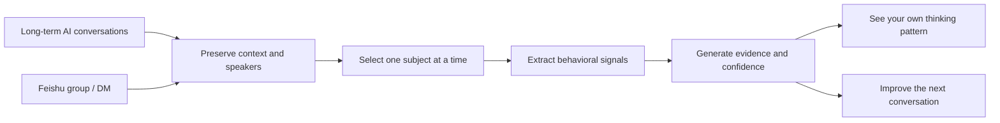

# KnowMe

English | [中文](./README.md)

## You may think you know yourself. Your conversation history may disagree.

> **Use KnowMe to stop mistaking “what I think” for “what is true.”**

This is not about arrogance. It is about the universal habit of treating “I believe I am this kind of person” as a fact.

KnowMe does not rely on your self-description. It analyzes your long-term AI conversations and real Feishu chats with managers, colleagues, and customers. From accumulated questions, decisions, and expressions, it helps reveal **how you actually think, why a relationship keeps getting stuck, and what to change next.**

[](https://github.com/AIPMAndy/KnowMe/stargazers)
[](https://github.com/AIPMAndy/KnowMe)
[](https://www.python.org/)
[](https://www.feishu.cn/)

**Subjective impressions protect “what I believe.” Real conversations preserve “what I did.”**

## The person we misread most easily is often ourselves

- You think you are empathetic, but your messages keep turning feelings into logic and solutions.
- You think your manager cannot see the long term, but your updates contain no milestones, data, or implementation detail.
- You think a colleague is rigid, but the chat history shows you repeatedly changing direction and disrupting the plan.
- You think you understand other people, but may only be interpreting them through your own rules.

Personality questionnaires record how people describe themselves. Long-term conversations record how they have already asked questions, evaluated information, pushed work forward, and made decisions. Conversation data is not a complete personality, but it is harder to polish than a one-time self-assessment.

## One idea, three situations

### 1. Self-awareness: remove the flattering filter

You may have always seen yourself as emotional, accepting, and empathetic. After importing a year of AI conversations, the recurring pattern might instead be “decide what is correct first” or “lead with the conclusion and data.” KnowMe does not decide which is better. It uses real traces of thought to separate **natural preference, learned ability, and self-image**.

### 2. Managing up: inspect your own attribution first

When updates repeatedly fail, it is easy to conclude that a manager lacks vision. The conversation may show something else: you speak in broad frameworks without milestones or a decision request, while the manager repeatedly asks for data, owners, and deadlines. Seeing the mismatch turns frustration into an actionable reporting structure.

### 3. Teamwork: bring conflict back to behavioral evidence

You call yourself flexible; your colleague says you always change things. Feishu history can bring the disagreement back to inspectable messages: whether you repeatedly introduce last-minute changes, and whether the other person consistently asks for a stable plan. KnowMe selects one speaker at a time and shows source excerpts. Seeing your own pattern before labeling a colleague “conservative” makes collaboration easier to repair.

## How KnowMe turns “I think” into evidence

| Previous problem | What KnowMe does | What you get |
|---|---|---|
| Self-assessments invite idealized answers | Analyze long-term natural conversations instead of another quiz | A self-profile closer to everyday behavior |
| Each side tells a different conflict story | Preserve every speaker and analyze one person at a time | No blended identity made from both sides |
| A personality label such as “ESTJ” is all you get | Show four dimensions, sample confidence, and source excerpts | Findings you can inspect instead of blindly trust |
| You see the difference but do not know what to change | Apply manager, colleague, and customer relationship context | Guidance for the next update, question, or request |
| Sensitive chats may be uploaded | Keep the open-source analyzer local without an external AI API | Raw data stays on your machine by default |

KnowMe can reflect yourself and help you understand others:

| Mode | Subject | Output |
|---|---|---|
| **Know yourself** | Your long-term ChatGPT, Claude, or OpenClaw conversations | Questioning, decision, and expression patterns with growth advice |
| **Understand others** | One selected participant in a Feishu or text conversation | Communication style, behavioral MBTI tendency, evidence, confidence, and next-step guidance |

## Feishu is where “what I believe” meets real work

AI conversations tend to reveal how someone thinks in private. Feishu conversations show how that thinking enters real collaboration. Through an authorized [`lark-cli`](https://github.com/larksuite/cli) connection, KnowMe can collect a Feishu group chat or direct message that you are allowed to access. It also accepts Feishu JSON and copied text.

Within the same Feishu conversation, select yourself to inspect your expression and collaboration habits, or select a manager, colleague, or customer to understand how they receive information and make decisions. **Only one speaker is analyzed at a time, so both sides never get blended into one personality.**



A result can look like this:

```text
Subject: Morgan Chen
Analysis mode: other
Relationship: manager
Sample: 64 subject messages / 137 total messages

Observed MBTI tendency: ESTJ
Communication guidance:
- Lead with the conclusion, then provide data and process
- Name the owner, deadline, and definition of done
- Pair a problem with the specific decision you need

Evidence excerpts: only messages written by Morgan
```

The personality label is not the destination. **Correcting one false attribution and preventing one misunderstanding or round of rework are what matter.**

## Analyze a Feishu conversation in three minutes

### 1. Install KnowMe and the Feishu CLI

```bash
git clone https://github.com/AIPMAndy/KnowMe.git
cd KnowMe

npm install -g @larksuite/cli
lark-cli auth login --domain im
lark-cli whoami
```

The KnowMe analyzer requires only Python 3.8+ and its standard library. Direct Feishu collection additionally requires `lark-cli`; importing exported JSON or copied text does not.

### 2. Find a Feishu group

```bash
lark-cli im +chat-search --as user --query "Project group" --format json
```

### 3. Select one person to analyze

```bash
python3 scripts/collect.py \
  --source feishu \
  --chat-id oc_xxx \
  --mode other \
  --target "Morgan Chen" \
  --self-name "Andy" \
  --relationship boss \
  --start 2026-07-01 \
  --output data.json

python3 scripts/analyze.py \
  --input data.json \
  --output report.md
```

For a direct message, replace `--chat-id oc_xxx` with the other person's Feishu `--user-id ou_xxx`.

To check whether the problem starts with your own communication, analyze only your messages from the same Feishu chat:

```bash
python3 scripts/collect.py \
  --source feishu \
  --chat-id oc_xxx \
  --mode self \
  --self-name "Andy" \
  --output my-data.json

python3 scripts/analyze.py --input my-data.json --output my-report.md
```

### No API access? Import copied text

```bash
python3 scripts/collect.py \
  --source feishu \
  --file ./feishu-chat.txt \
  --mode other \
  --target "Morgan Chen" \
  --self-name "Andy" \
  --relationship colleague \
  --output data.json

python3 scripts/analyze.py --input data.json --output report.md
```

Accepted inputs include raw `lark-cli` JSON, a `messages` array with sender fields, copied Feishu `Name Time` blocks, and `Name: message` text.

## Know yourself through AI conversations

```bash
python3 scripts/collect.py \
  --source chatgpt \
  --file ~/Downloads/conversations.json \
  --mode self \
  --output data.json

python3 scripts/analyze.py --input data.json --output report.md
python3 scripts/advise.py --report report.md --output advice.md
```

Claude exports and OpenClaw workspaces are also supported. As an Agent Skill, you can ask:

- “Analyze my Feishu conversation with my manager, using only their messages.”
- “Analyze only my own messages in this Feishu chat. Is the problem starting with me?”
- “How does this colleague prefer to receive information?”
- “Based on this conversation, how should I frame my next update?”
- “Analyze my personality from my AI conversations.”

<details>
<summary>View a self-analysis terminal report</summary>


</details>

## What the report contains

- the selected subject and `self` / `other` mode;
- source, relationship context, subject sample size, and total messages;
- E/I, S/N, T/F, and J/P tendencies with confidence;
- short evidence excerpts only from the selected person's messages;
- communication style, topic distribution, and relationship-specific guidance;
- sample limitations, appropriate boundaries, and prohibited high-impact uses.

More messages across more days and topics generally produce a more stable profile:

- fewer than 20 subject messages: low confidence;
- 20-49 messages: directional only;
- 50+ messages across multiple days and topics: preferred.

## Supported sources

| Source | Collection method | Subject |
|---|---|---|
| **Feishu group / DM** | `--source feishu --chat-id/--user-id` | Selected participant |
| **Feishu JSON / copied text** | `--source feishu --file` | Selected participant |
| **ChatGPT** | `--source chatgpt --file conversations.json` | Self |
| **Claude** | `--source claude --file export.json` | Self |
| **OpenClaw** | `--source openclaw` | Self |
| **Plain text** | `--source text --file` | Self in AI conversations |

## Privacy and limits

- Analyze only conversations you are authorized to access, with participant consent where appropriate.
- Raw chats stay local by default; the analyzer does not call an external AI API.
- During direct collection, only the authorized `lark-cli` connection accesses Feishu.
- Analysis of another person is a text-based communication hypothesis, not a psychological or clinical diagnosis.
- Do not infer protected traits, mental health, honesty, or hidden intent.
- Do not use the output to manipulate, exclude, hire, fire, or make another high-impact decision.
- Verify important conclusions through direct communication.

## Project structure

```text
KnowMe/
├── SKILL.md
├── agents/openai.yaml
├── scripts/
│   ├── collect.py
│   ├── analyze.py
│   ├── advise.py
│   ├── auto_collect.py
│   └── generate_portrait.py
├── references/
│   ├── mbti_signals.md
│   ├── relationship_analysis.md
│   └── advice_frameworks.md
└── tests/test_pipeline.py
```

## Validation

```bash
python3 -m unittest discover -s tests -v
python3 -m compileall -q scripts tests
```

## Roadmap

- [x] ChatGPT / Claude / OpenClaw self-analysis
- [x] Direct Feishu group and DM collection
- [x] Feishu JSON and copied-text import
- [x] One-person targeting without mixed speakers
- [x] Workplace context and actionable communication guidance
- [x] Evidence excerpts and sample-size confidence
- [ ] Web UI
- [ ] WeChat conversation parser
- [ ] Big Five and timeline analysis

If KnowMe helps remove one flattering assumption, false attribution, or round of communication rework, [give it a Star](https://github.com/AIPMAndy/KnowMe) so more people can find it.

## License

[Apache 2.0](LICENSE)

Built by [AI酋长Andy](https://github.com/AIPMAndy).
