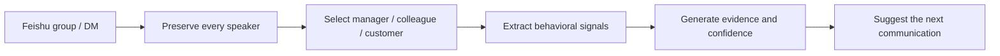

# KnowMe

English | [中文](./README.md)

## When your manager says “think it through again,” what do they actually need from you?

> **Not another MBTI quiz. KnowMe turns real Feishu conversations into an evidence-based communication guide.**

Select a manager, colleague, or customer. KnowMe analyzes only the messages they wrote, identifies how they take in information and make decisions, and suggests **how to approach the next update, question, or request.**

[](https://github.com/AIPMAndy/KnowMe/stargazers)
[](https://github.com/AIPMAndy/KnowMe)
[](https://www.python.org/)
[](https://www.feishu.cn/)

**Understand people through what they actually said, not what a quiz says about them.**

## Communication is hard when you do not know the other person's rules

- Does “looks fine” mean approval, or are you expected to keep moving on your own?
- Is a detail-oriented colleague being difficult, or gathering enough information to decide?
- Is a quiet customer uninterested, or still waiting for evidence that lowers the risk?
- You know everyone's MBTI label, but still do not know how to write the next Feishu message.

Self-reported tests measure what people believe they would do. Real conversations capture how they already ask questions, evaluate information, push work forward, and make decisions. KnowMe does not read minds or claim to reveal hidden intent. It turns observable patterns into a **practical hypothesis for the next conversation**.

## What KnowMe changes

| Common approach | What goes wrong | KnowMe's approach |
|---|---|---|
| Guess what the other person means | Emotion is easily mistaken for evidence | Analyze patterns in their real Feishu messages |
| Send an entire chat to a generic AI | Both speakers get mixed into one profile | Preserve speakers and select exactly one subject |
| Get an “ESTJ” label | No evidence and no way to judge confidence | Show dimensions, confidence, and source excerpts |
| Learn a type but not what to say | Insight never becomes action | Give relationship-specific communication guidance |
| Upload sensitive conversations | Privacy boundaries are unclear | Run analysis locally without an external AI API |

KnowMe has two modes:

| Mode | Subject | Output |
|---|---|---|
| **Understand others** | One selected participant in a Feishu or text conversation | Communication style, behavioral MBTI tendency, evidence, confidence, and next-step guidance |
| **Know yourself** | Your long-term ChatGPT, Claude, or OpenClaw conversations | Questioning, decision, and expression patterns with growth advice |

## Feishu is the core workplace workflow, not a checkbox

Through an authorized [`lark-cli`](https://github.com/larksuite/cli) connection, KnowMe can collect a Feishu group chat or direct message that you are allowed to access. It also accepts Feishu JSON and copied text. Speaker identity is preserved throughout, and only the selected person's messages enter the analysis.



A result can look like this:

```text
Subject: Morgan Chen
Analysis mode: other
Relationship: manager
Sample: 64 subject messages / 137 total messages

Observed MBTI tendency: ESTJ
Communication guidance:
- Lead with the conclusion, then provide data and process
- Name the owner, deadline, and definition of done
- Pair a problem with the specific decision you need

Evidence excerpts: only messages written by Morgan
```

The personality label is not the destination. **Fewer misunderstandings and less rework in the next conversation are what matter.**

## Analyze a Feishu conversation in three minutes

### 1. Install KnowMe and the Feishu CLI

```bash
git clone https://github.com/AIPMAndy/KnowMe.git
cd KnowMe

npm install -g @larksuite/cli
lark-cli auth login --domain im
lark-cli whoami
```

The KnowMe analyzer requires only Python 3.8+ and its standard library. Direct Feishu collection additionally requires `lark-cli`; importing exported JSON or copied text does not.

### 2. Find a Feishu group

```bash
lark-cli im +chat-search --as user --query "Project group" --format json
```

### 3. Select one person to analyze

```bash
python3 scripts/collect.py \
  --source feishu \
  --chat-id oc_xxx \
  --mode other \
  --target "Morgan Chen" \
  --self-name "Andy" \
  --relationship boss \
  --start 2026-07-01 \
  --output data.json

python3 scripts/analyze.py \
  --input data.json \
  --output report.md
```

For a direct message, replace `--chat-id oc_xxx` with the other person's Feishu `--user-id ou_xxx`.

### No API access? Import copied text

```bash
python3 scripts/collect.py \
  --source feishu \
  --file ./feishu-chat.txt \
  --mode other \
  --target "Morgan Chen" \
  --self-name "Andy" \
  --relationship colleague \
  --output data.json

python3 scripts/analyze.py --input data.json --output report.md
```

Accepted inputs include raw `lark-cli` JSON, a `messages` array with sender fields, copied Feishu `Name Time` blocks, and `Name: message` text.

## Know yourself through AI conversations

```bash
python3 scripts/collect.py \
  --source chatgpt \
  --file ~/Downloads/conversations.json \
  --mode self \
  --output data.json

python3 scripts/analyze.py --input data.json --output report.md
python3 scripts/advise.py --report report.md --output advice.md
```

Claude exports and OpenClaw workspaces are also supported. As an Agent Skill, you can ask:

- “Analyze my Feishu conversation with my manager, using only their messages.”
- “How does this colleague prefer to receive information?”
- “Based on this conversation, how should I frame my next update?”
- “Analyze my personality from my AI conversations.”

<details>
<summary>View a self-analysis terminal report</summary>


</details>

## What the report contains

- the selected subject and `self` / `other` mode;
- source, relationship context, subject sample size, and total messages;
- E/I, S/N, T/F, and J/P tendencies with confidence;
- short evidence excerpts only from the selected person's messages;
- communication style, topic distribution, and relationship-specific guidance;
- sample limitations, appropriate boundaries, and prohibited high-impact uses.

More messages across more days and topics generally produce a more stable profile:

- fewer than 20 subject messages: low confidence;
- 20-49 messages: directional only;
- 50+ messages across multiple days and topics: preferred.

## Supported sources

| Source | Collection method | Subject |
|---|---|---|
| **Feishu group / DM** | `--source feishu --chat-id/--user-id` | Selected participant |
| **Feishu JSON / copied text** | `--source feishu --file` | Selected participant |
| **ChatGPT** | `--source chatgpt --file conversations.json` | Self |
| **Claude** | `--source claude --file export.json` | Self |
| **OpenClaw** | `--source openclaw` | Self |
| **Plain text** | `--source text --file` | Self in AI conversations |

## Privacy and limits

- Analyze only conversations you are authorized to access, with participant consent where appropriate.
- Raw chats stay local by default; the analyzer does not call an external AI API.
- During direct collection, only the authorized `lark-cli` connection accesses Feishu.
- Analysis of another person is a text-based communication hypothesis, not a psychological or clinical diagnosis.
- Do not infer protected traits, mental health, honesty, or hidden intent.
- Do not use the output to manipulate, exclude, hire, fire, or make another high-impact decision.
- Verify important conclusions through direct communication.

## Project structure

```text
KnowMe/
├── SKILL.md
├── agents/openai.yaml
├── scripts/
│   ├── collect.py
│   ├── analyze.py
│   ├── advise.py
│   ├── auto_collect.py
│   └── generate_portrait.py
├── references/
│   ├── mbti_signals.md
│   ├── relationship_analysis.md
│   └── advice_frameworks.md
└── tests/test_pipeline.py
```

## Validation

```bash
python3 -m unittest discover -s tests -v
python3 -m compileall -q scripts tests
```

## Roadmap

- [x] ChatGPT / Claude / OpenClaw self-analysis
- [x] Direct Feishu group and DM collection
- [x] Feishu JSON and copied-text import
- [x] One-person targeting without mixed speakers
- [x] Workplace context and actionable communication guidance
- [x] Evidence excerpts and sample-size confidence
- [ ] Web UI
- [ ] WeChat conversation parser
- [ ] Big Five and timeline analysis

If KnowMe saves you one round of guessing or rework, [give it a Star](https://github.com/AIPMAndy/KnowMe) so more people can find it.

## License

[Apache 2.0](LICENSE)

Built by [AI酋长Andy](https://github.com/AIPMAndy).
